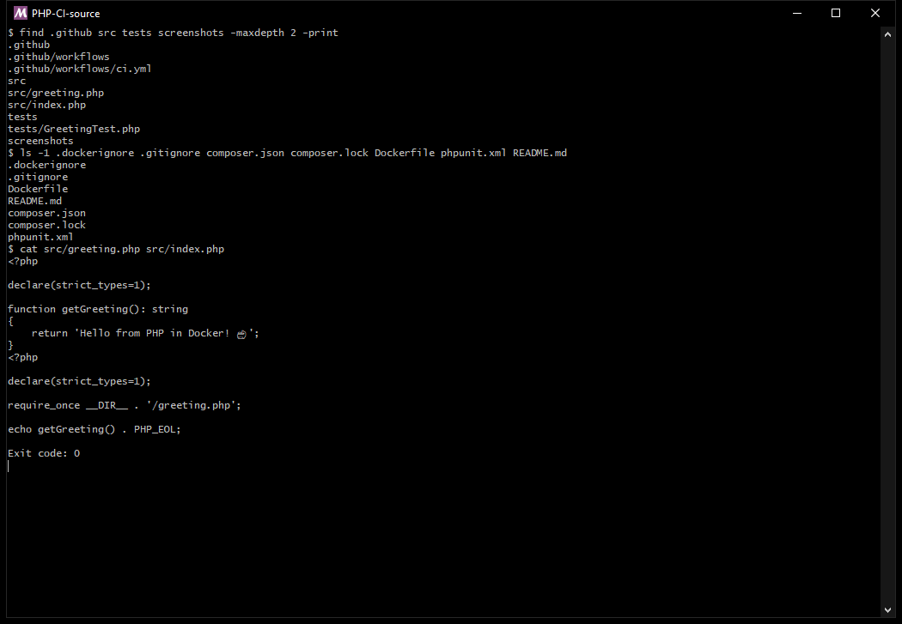

# Pipeline CI на PHP в GitHub Actions

Десятая практическая работа. Цель — настроить CI для консольного приложения PHP 8.2: проверить исходники и тесты, собрать Docker-образ и сохранить его как артефакт. Программа выводит `Hello from PHP in Docker! 🐳`. [Методичка преподавателя](https://github.com/rurewa/imfua/blob/main/content/DevOps/CI_CD/Pipelines/PHP.md)

Проверки ниже выполнены локально. Первый запуск GitHub Actions состоится после публикации проекта в `main`.

## Структура проекта

| Файл или каталог | Назначение |
| --- | --- |
| `src/greeting.php` | Функция `getGreeting()` возвращает строку в UTF‑8. |
| `src/index.php` | PHP CLI подключает функцию и выводит результат с переводом строки. |
| `tests/GreetingTest.php`, `phpunit.xml` | Четыре теста, настройки запуска PHPUnit и обязательная непустая коллекция тестов. |
| `composer.json`, `composer.lock` | Требования проекта и зафиксированные зависимости для тестов. |
| `Dockerfile`, `.dockerignore` | Две стадии на PHP CLI и минимальный контекст приложения. |
| `.github/workflows/ci.yml` | Три последовательных задания GitHub Actions. |
| `.gitignore`, `screenshots/` | Исключения Git и фактические снимки работы. |

## PHP, Composer и PHPUnit

PHP CLI выполняет `src/index.php`. Первые три теста PHPUnit вызывают рабочую функцию и проверяют точную строку и наличие слов PHP и Docker. Четвёртый тест запускает точку входа отдельным процессом и сравнивает stdout, stderr и код завершения. Composer устанавливает тестовые зависимости из lock-файла. [Совместимость версий PHPUnit](https://phpunit.de/supported-versions.html)

## Локальные проверки в Windows PowerShell

Откройте PowerShell в корне проекта. Команды используют Docker Desktop в режиме Linux-контейнеров и не требуют установленного PHP на Windows.

Для Composer соберите локальный образ проверки. В нём PHP 8.2 предоставляет `mbstring`, Composer берётся из официального образа, а `unzip` распаковывает пакеты.

~~~powershell
$recipe = @(
    'FROM composer:2 AS composer'
    'FROM php:8.2-cli-bookworm'
    'RUN sed -i ''s|http://deb.debian.org|https://deb.debian.org|g'' /etc/apt/sources.list.d/debian.sources \'
    '    && apt-get update \'
    '    && apt-get install -y --no-install-recommends unzip \'
    '    && rm -rf /var/lib/apt/lists/*'
    'COPY --from=composer /usr/bin/composer /usr/local/bin/composer'
) -join [char]10
$recipe | docker build -t my-php-app-check:local -
~~~

~~~powershell
$source = (Resolve-Path -LiteralPath .).Path
$bind = "type=bind,source=$source,target=/app"
docker run --rm --mount $bind -w /app my-php-app-check:local composer validate --strict
docker run --rm --mount $bind -w /app my-php-app-check:local composer install --no-interaction --no-progress --prefer-dist
docker run --rm --network none --mount "$bind,readonly" -w /app php:8.2-cli-bookworm bash -eo pipefail -c 'find src tests -type f -name "*.php" -print0 | xargs -0 -r -n 1 php -l'
docker run --rm --network none --mount "$bind,readonly" -w /app php:8.2-cli-bookworm php vendor/bin/phpunit --configuration phpunit.xml --testdox
~~~

## Docker

Стадия `builder` проверяет синтаксис приложения перед копированием. Стадия запуска использует PHP CLI, содержит только исходники и запускает PHP от `appuser`.

~~~powershell
docker build -t my-php-app:latest .
docker run --rm --network none my-php-app:latest
$LASTEXITCODE
docker run --rm --network none my-php-app:latest id
~~~

Ожидаемая строка — `Hello from PHP in Docker! 🐳`. Код выхода должен быть `0`, а `id` должен показать `appuser` с UID больше нуля.

## GitHub Actions

Workflow реагирует на push и pull request для `main` и `master`. На вкладке Actions также доступен ручной запуск **PHP CI Pipeline**.

1. **Syntax Check** проверяет Composer и синтаксис всех PHP-файлов в Git.
2. **Run Tests** устанавливает зависимости из `composer.lock` и выполняет PHPUnit.
3. **Build Docker Image** собирает образ через Buildx, сохраняет `docker-image.tar.gz` как артефакт **docker-image** на семь дней и проверяет запуск. Образ остаётся в артефакте GitHub Actions.

## Локальные результаты

| Проверка | Результат |
| --- | --- |
| PHP 8.2 CLI | Синтаксис трёх PHP-файлов корректен. |
| Composer | `validate --strict` и установка из `composer.lock` прошли. |
| PHPUnit | 4 теста, 7 проверок. |
| Workflow | `actionlint` 1.7.12 прошёл. |
| Docker | Сборка и `docker save` прошли. Контейнер вывел точное UTF‑8-приветствие, завершился с кодом `0`, работал от `appuser` с UID `1000`. |

## Технические отличия от методички

- `getGreeting()` вынесена из точки входа. Тесты функции могут загрузить её без вывода в stdout. Отдельный тест проверяет запуск `index.php`.
- Добавлены Composer и PHPUnit 11, совместимый с PHP 8.2. CI устанавливает зафиксированные зависимости. Проверка синтаксиса передаёт ошибки PHP через код выхода `xargs`, а ошибки Composer и PHPUnit останавливают задания.
- Для обеих стадий Docker выбран официальный `php:8.2-cli-bookworm`. Образ запуска содержит исходники приложения. PHPUnit и зависимости остаются в среде тестирования.
- Обновлены `checkout@v7`, `setup-buildx-action@v4`, `build-push-action@v7` и `upload-artifact@v7`. Для PHP используется `shivammathur/setup-php@v2`. Артефакт формируется в `RUNNER_TEMP`, а проверка образа сравнивает точный stdout, код выхода, имя пользователя и UID.

## Скриншоты локальных проверок

### Структура проекта и исходники

### Проверка синтаксиса трёх PHP-файлов

### Четыре теста PHPUnit

### Сборка Docker-образа

### Приветствие, код выхода и пользователь контейнера

